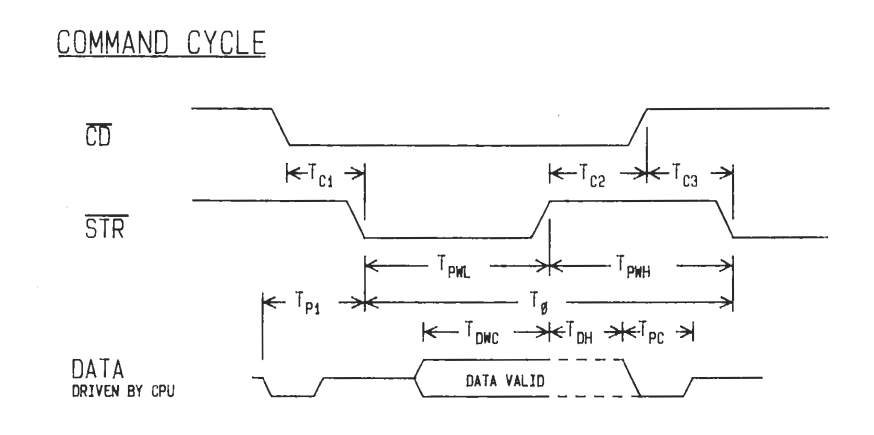
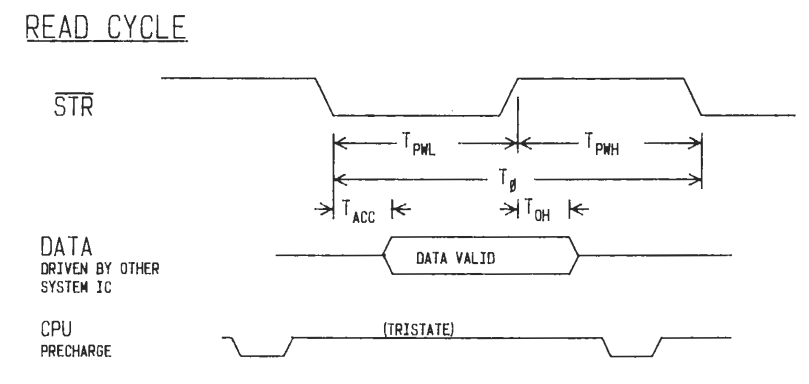
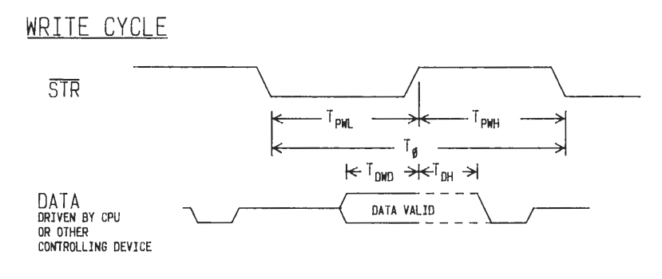

# The HP-71B Bus
The core of the HP-71B device bus consists of a four-bit bidirectional data path and two active low control signals; Strobe (STRN) and Command/Data (CDN). The Strobe control line begins an asynchronous bus communication cycle with its falling edge. On the rising edge of the cycle, data or command values will be stable and ready to be sampled. If the CPU is reading data from a device, then the device must have its data asserted and ready to be sampled by the CPU. The following images, taken from the HP-71 Hardware IDS illustrate the bus timing.

A command cycle is distinguished from a read or write cycle by the assertion of the Command/Data active low signal. The command can be sampled on the rising edge of the Strobe signal. The command then becomes the active bus state at the start of the next bus cycle. The sixteen bus commands are

| Command   |   Command    |  Command    |  Command |
| -------   |   -------    |  -------    |  ------- |
| 0 NOP     |   4 PCWRITE  |  8 CONFIG   |  C BUSCC |
| 1 ID      |   5 DPWRITE  |  9 UNCONFIG |  D RSV2 |
| 2 PCREAD  |   6 LOADPC   |  A POLL     |  E SHUTDOWN |
| 3 DPREAD  |   7 LOADDP   |  B RSV1     |  F RESET |

In a read cycle the HP-71B CPU expects data from a device attached to the bus. A read cycle is initiated by either the PCREAD or DPREAD command. Because of the synchronous character of clocked memory there is always one dead cycle at the start of a read cycle. Data is read using the incremented address of the PC or DP register selected by the PCREAD or DPREAD command until terminated by another bus command.

Note that following a LOADPC or LOADDP command, a device will automatically switch to a READPC or READDP state unless overridden by another bus command.

Similar to a read cycle, data is written to a device following a PCWRITE or DPWRITE command. Valid data immediately follows the beginning of the write cycle until terminated by another bus command. Write data to a device will be stable in the rising edge of the Strobe signal. The PC or DP address register selected by a PCWRITE or DPWRITE command is incremented after each write cycle.

