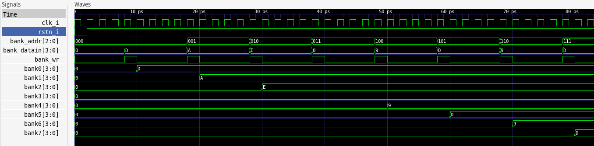
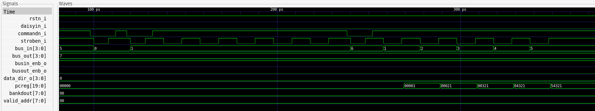
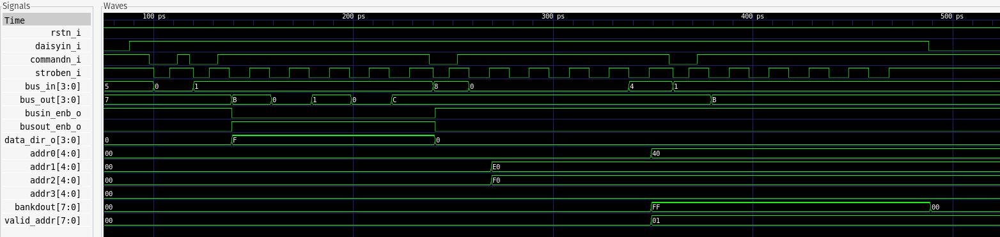

# Verilator Test Bench For HP71B Bus Module
Note: The files herein for verification testing of the HP-71B bus interface were inspired by the tutorial published on itsembedded.com by Norbert Kremeris.
You can find the tutorial [here](https://itsembedded.com/dhd/verilator_1/).

The following files and directories are used to create a set of test benches for the hp71b.v module.

- **Makefile** Used to build the various test benches
- **testbench** Directory containing the different test bench files

## Build
Use the following commands to build the various test benches

```
make waves_tb1
make waves_tb2
make waves_tb3
```
Use the appropriate _tb[1-9] postfix to view each test bench result using gtkwave.

## Test Benches
The first test bench verifies that the SPRAM bank configuration registers can be properly loaded. Each register controls how the bankis treated by the HP-71B.



Test bench two shows how the MultiMod II responds after reset or when the 71B turns on and has yet to configure the MultiMod II. The ID command is ignored since Daisy-In is not asserted, but the LOAD PC command is processed.



The third test bench shows the MultiMod II responding to the ID and CONFIG commands during the HP-71B device query and configuration process. SPRAM bank 0 holds the 16KB (32Knib) Forth/Assembler ROM, and banks 1 and 2 hold the Forth Hard ROM. Since there are no other soft ROMs in SPRAM, the second ID command is ignored.


